# Manual de usuario — TecnoXela

Guía paso a paso para usar la tienda en línea TecnoXela, tanto como **cliente** como **administrador**.
La aplicación funciona igual en computadora y en teléfono; en pantallas pequeñas el menú se abre con el
botón de **dos líneas** de la esquina superior derecha.

**Versión:** 26/10/2026.

> Dirección de la tienda en la demostración: **http://localhost:3000**

---

## Parte 1. Cliente

### 1.1 Ver el catálogo (sin cuenta)

1. Abre la tienda. La página principal muestra los productos disponibles con su precio y disponibilidad,
   de 12 en 12. Al final de la lista, **Ver N productos más** carga los siguientes.
2. Para encontrar un producto:
   - Escribe en el buscador **¿Qué estás buscando hoy?** (busca por nombre y descripción; los resultados
     aparecen al dejar de escribir o al tocar el botón morado de la flecha).
   - Toca una **categoría** (Audio, Computación, Almacenamiento, Accesorios, Wearables) o **Todas**.
   - Cambia el orden con **Ordenar**: por nombre, precio de menor a mayor, de mayor a menor o más recientes.
3. Toca el nombre o la imagen de un producto para ver su **detalle**: descripción, precio y unidades disponibles.
4. Si una búsqueda no encuentra nada, el botón **Ver todos los productos** quita los filtros.

Sobre la imagen de cada producto aparece **¡Quedan N!** (5 unidades o menos) o **Agotado** (no se puede
agregar). En el detalle, un punto verde indica cuántas unidades hay disponibles.

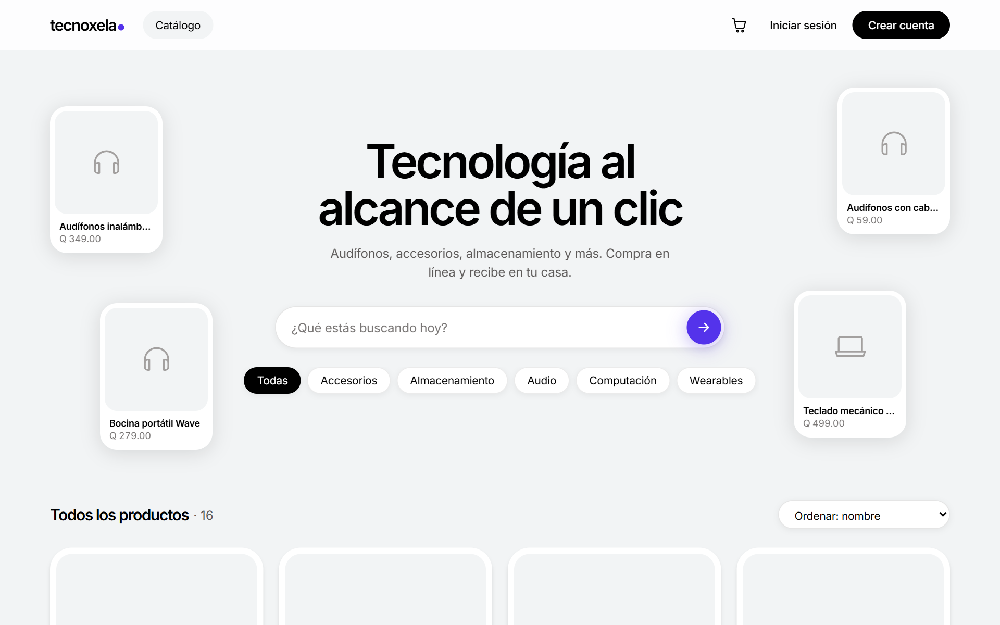

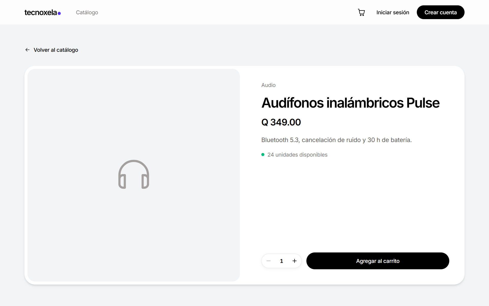

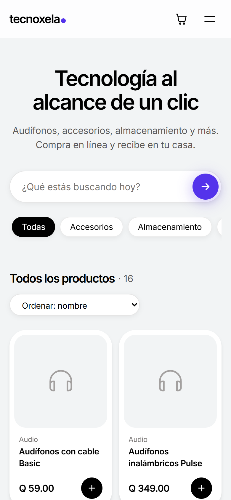

### 1.2 Crear una cuenta

1. Toca **Crear cuenta** en el encabezado.
2. Completa **Nombre completo**, **Correo electrónico** y **Contraseña** (y su confirmación).
   Teléfono y dirección son opcionales, pero la dirección se usa como sugerencia al comprar.
3. La contraseña debe tener **al menos 8 caracteres, una letra y un número**.
4. Toca **Crear cuenta**. Quedarás con la sesión iniciada.

Si el correo ya está registrado, la tienda te lo indica; usa **Iniciar sesión** en su lugar.

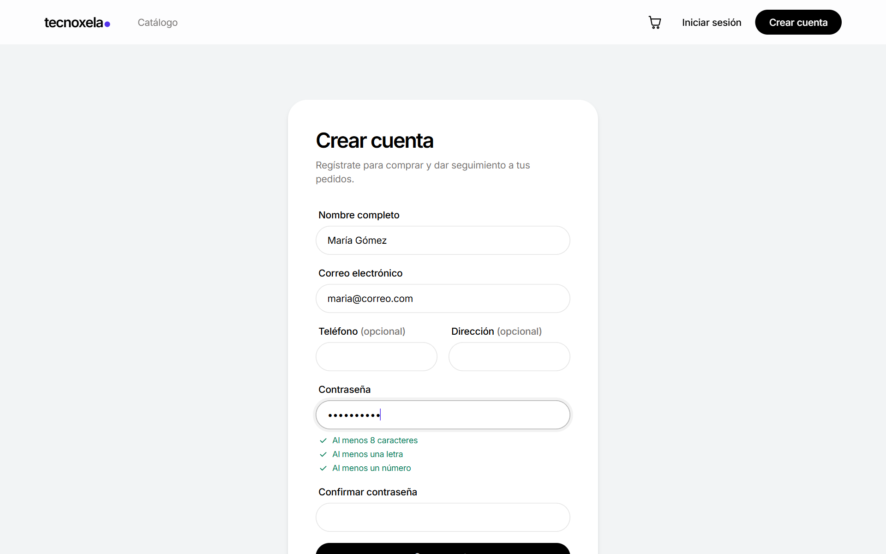

### 1.3 Iniciar y cerrar sesión

1. Toca **Iniciar sesión**, escribe tu correo y contraseña y confirma.
2. Si intentaste agregar algo al carrito sin sesión, al entrar vuelves a la página donde estabas.
3. Con la sesión iniciada, el encabezado muestra un círculo con tu inicial y tu nombre (abre **Mi perfil**)
   y el botón **Salir**. En el teléfono ambos están dentro del menú.

Por seguridad, la sesión vence sola después de 8 horas; solo tienes que volver a iniciarla. Después de
muchos intentos fallidos seguidos, la tienda pide esperar unos minutos.

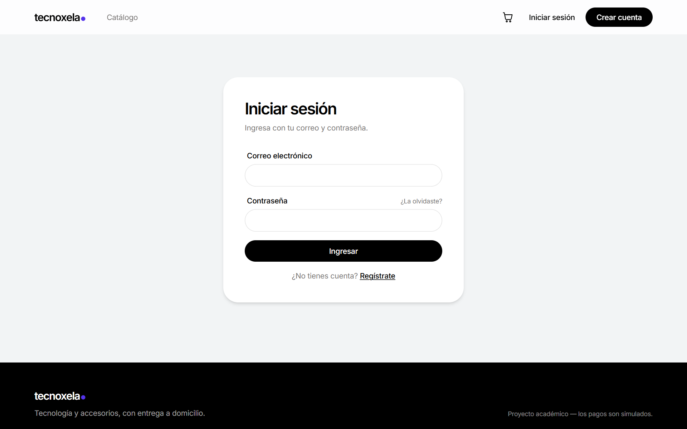

### 1.3.1 Recuperar la contraseña

1. En **Iniciar sesión** toca **¿La olvidaste?**, junto al campo de contraseña.
2. Escribe el correo de tu cuenta y toca **Enviar enlace**.
3. Abre el enlace que te llega (vence en **30 minutos** y sirve una sola vez).
4. Escribe la contraseña nueva dos veces y toca **Guardar contraseña**. Después inicia sesión con ella.

Al restablecer la contraseña se cierran las sesiones que estuvieran abiertas en otros dispositivos.
Si pides varios enlaces, solo el último funciona.

> **En este proyecto el correo es simulado:** el mensaje con el enlace aparece en la consola (terminal)
> donde corre el backend. Por seguridad, la tienda responde lo mismo exista o no la cuenta.

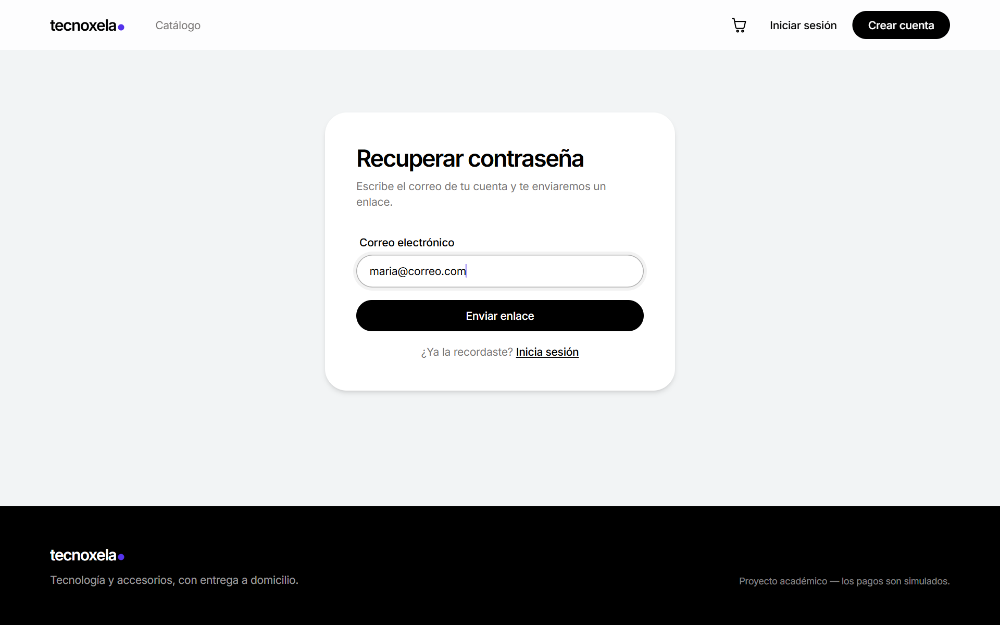

### 1.4 Agregar productos al carrito

1. En el catálogo toca el botón **+** de la tarjeta, o en el detalle elige la cantidad y toca **Agregar al carrito**.
2. El botón **+** se vuelve verde con un ✓ por un momento, aparece un aviso abajo y el número del ícono
   del carrito aumenta.
3. Si pides más unidades de las que hay, la tienda te indica cuántas quedan disponibles.

### 1.5 Modificar el carrito

Toca el ícono del carrito en el encabezado para abrir **Tu carrito**. Ahí puedes:

| Acción | Cómo |
|---|---|
| Aumentar o reducir la cantidad | Botones **+** y **−** de cada producto |
| Quitar un producto | **Eliminar** |
| Quitar todo | **Vaciar carrito** |
| Seguir viendo productos | **Seguir comprando** |

El **Resumen** muestra el número de productos, el envío (gratis) y el **Total**, que se recalcula con
cada cambio. Si un producto se agotó mientras estaba en tu carrito, se marca para que ajustes la cantidad.

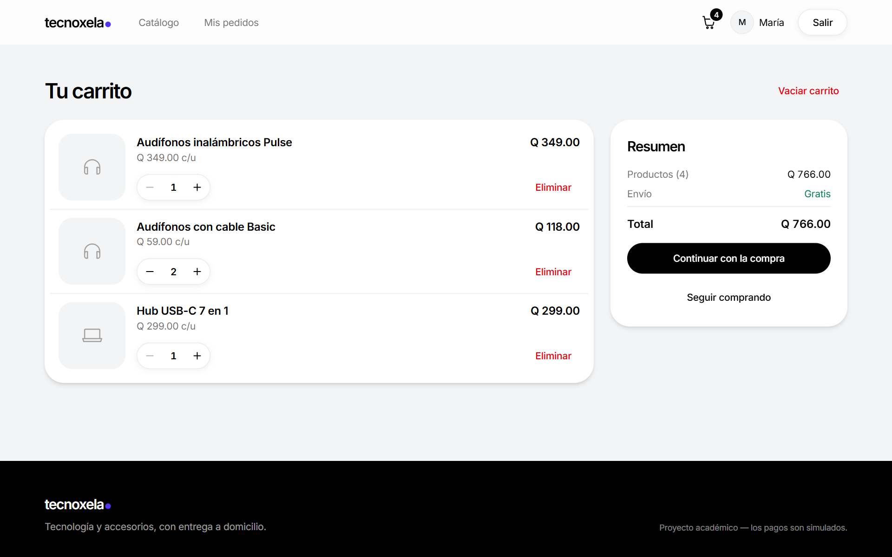

### 1.6 Confirmar la compra

1. En el carrito toca **Continuar con la compra**.
2. Revisa o escribe la **Dirección de entrega**.
3. Elige el método de pago:
   - **Tarjeta**: escribe número, nombre del titular, vencimiento (MM/AA) y CVV.
   - **Contra entrega**: pagas al recibir el pedido.
4. Toca **Confirmar compra · Q total**.
5. Verás la pantalla **¡Gracias por tu compra!** con el número de pedido, los productos, el total, la
   dirección y el comprobante del pago.

> **Los pagos son simulados.** No se cobra dinero real. Para la demostración usa:
> - `4242 4242 4242 4242` → pago aprobado
> - `4000 0000 0000 0002` → pago rechazado por el banco (no se crea el pedido ni se descuenta nada)
>
> Cualquier fecha futura y cualquier CVV de 3 dígitos. La tienda nunca guarda el número completo
> ni el CVV; en el comprobante solo aparece la marca y los últimos 4 dígitos.

Si mientras comprabas otra persona compró las últimas unidades, la tienda te avisa qué producto ya no
alcanza y no realiza el cobro.

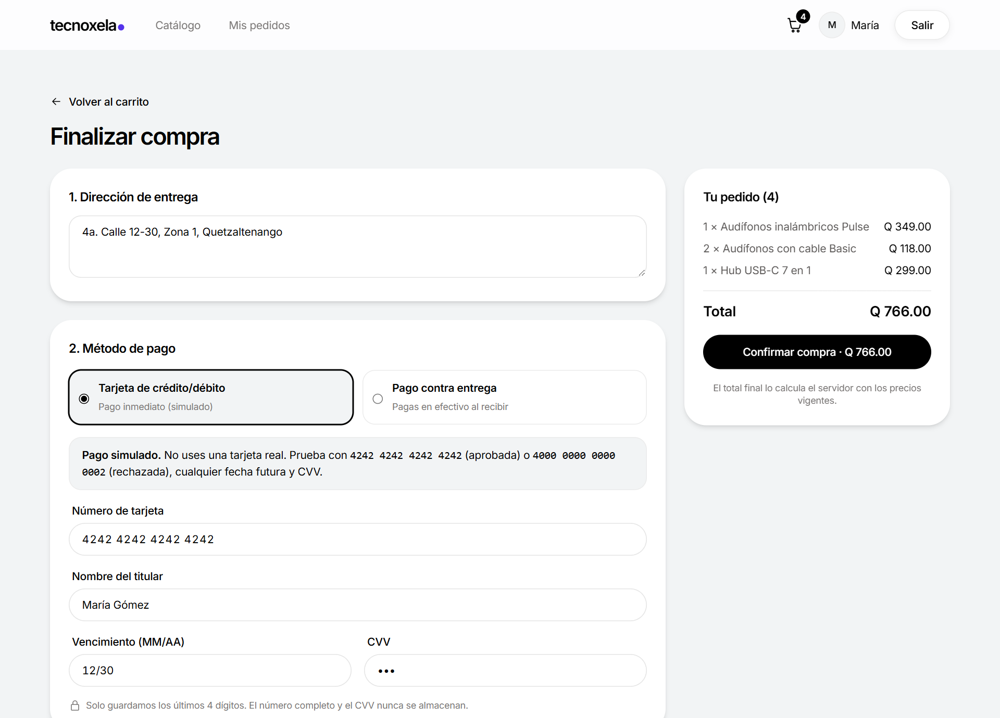

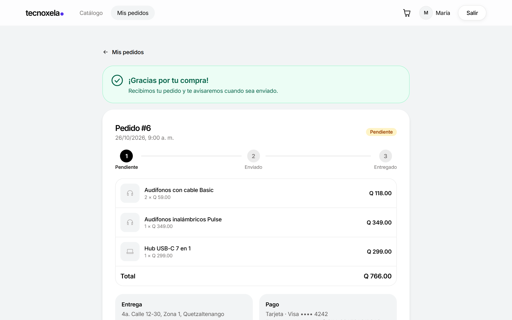

### 1.7 Consultar mis pedidos

1. Toca **Mis pedidos** en el encabezado.
2. Verás la lista con número, fecha, unidades, total y estado.
3. Toca un pedido para ver su detalle y la línea de seguimiento:

| Estado | Significado |
|---|---|
| **Pendiente** | La tienda recibió el pedido y lo está preparando |
| **Enviado** | El pedido va en camino |
| **Entregado** | El pedido llegó |
| **Cancelado** | El pedido se anuló y las unidades regresaron al inventario |

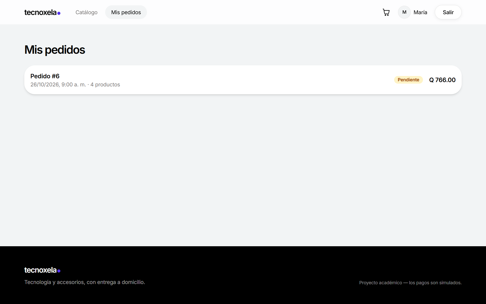

### 1.8 Cancelar un pedido

Mientras el pedido esté **Pendiente**, ábrelo y toca **Cancelar pedido** y confirma. Una vez enviado ya
no se puede cancelar desde la tienda.

### 1.9 Mi perfil

Toca tu nombre en el encabezado (o **Mi perfil** en el menú del teléfono) para:

- Cambiar **Datos personales** (nombre, teléfono y dirección) y tocar **Guardar cambios**.
- **Cambiar contraseña**: escribe la contraseña actual y la nueva, y toca **Actualizar contraseña**.
  Tu sesión actual sigue abierta, pero se cierran las de otros dispositivos.

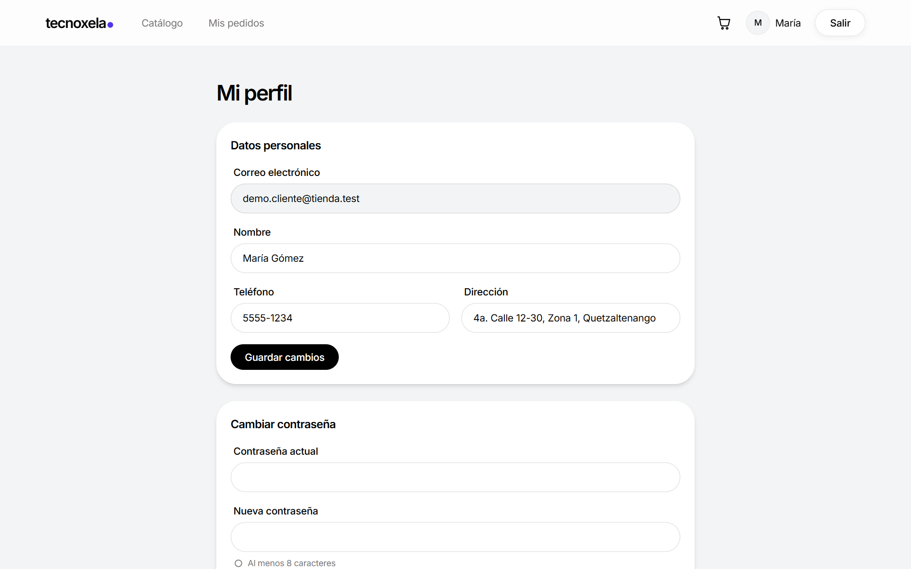

---

## Parte 2. Administrador

Inicia sesión con una cuenta de administrador. Entrarás directamente al **Panel de administración**.
El menú lateral (pestañas en el teléfono) tiene: **Resumen, Productos, Inventario, Pedidos y Usuarios**.
**Ver tienda** abre la vista del cliente y **Salir** cierra la sesión.

En el teléfono, las tablas se muestran como tarjetas: cada fila es un bloque con el nombre de cada dato a
la izquierda. Las listas largas de productos, pedidos y usuarios se muestran de 15 en 15; **Ver N más**
carga las siguientes.

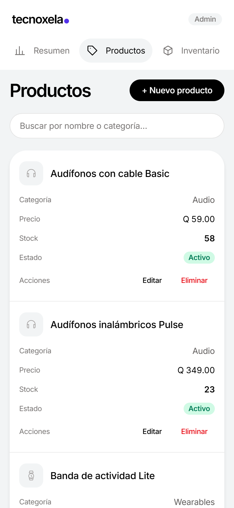

### 2.1 Resumen

Muestra de un vistazo:

- **Ventas totales** y ventas del mes (sin contar pedidos cancelados).
- **Pedidos** totales y cuántos están pendientes.
- **Clientes** registrados y activos.
- **Stock bajo**: productos en o por debajo de su mínimo.
- Gráfica de **ventas de los últimos 7 días**, **pedidos por estado**, **alertas de stock bajo**
  (con acceso directo a Inventario), **productos más vendidos** y **pedidos recientes**.

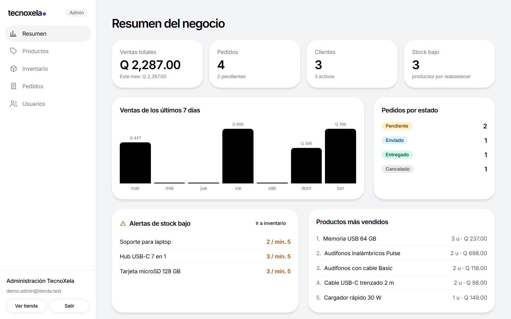

### 2.2 Productos

**Agregar un producto**

1. Toca **+ Nuevo producto**.
2. Completa nombre, descripción, precio (Q), categoría (puedes elegir una existente o escribir una nueva),
   **stock inicial** y **stock mínimo** (cantidad a partir de la cual se muestra la alerta).
3. Opcional: la **foto del producto**. Toca **Subir foto** o arrastra la imagen al recuadro
   (PNG, JPG o WebP de hasta 2 MB). También puedes abrir **O usar una URL de internet** y pegar una
   dirección `https://…`. **Quitar** borra la foto. Sin foto se muestra el ícono de su categoría.
4. Deja marcado **Visible en la tienda** y toca **Guardar**.

**Editar un producto**

1. Busca el producto y toca **Editar**.
2. Cambia los datos y toca **Guardar**. Los pedidos anteriores conservan el precio con que se vendieron.
3. El stock se muestra pero **no se edita aquí**: se ajusta en **Inventario**. Así no se pierden las
   ventas que ocurran mientras el formulario está abierto.

**Eliminar un producto**

1. Toca **Eliminar** y confirma.
2. El producto deja de verse en la tienda y se retira de los carritos, pero se conserva en el historial
   de pedidos. Aparece como **Inactivo** en la lista.
3. Para volver a publicarlo, toca **Editar**, marca **Visible en la tienda** y guarda.

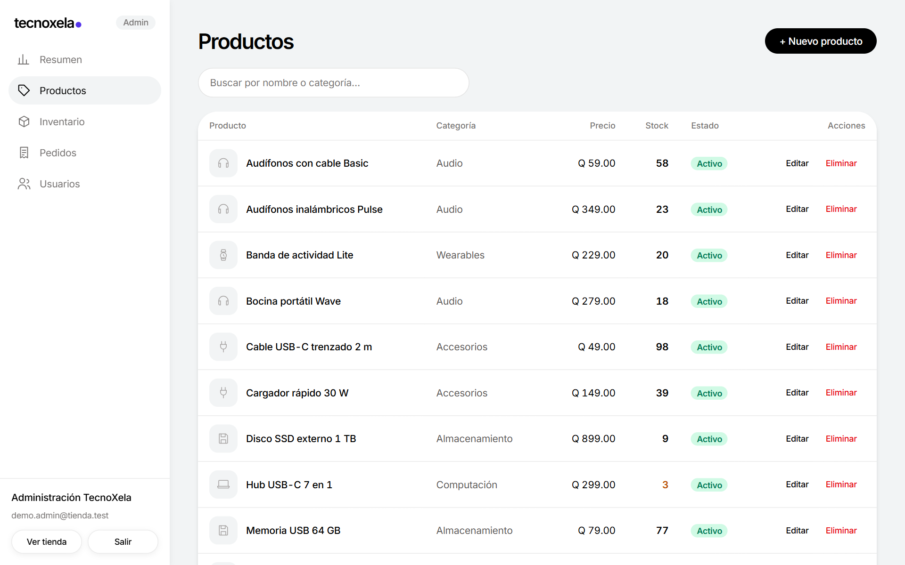

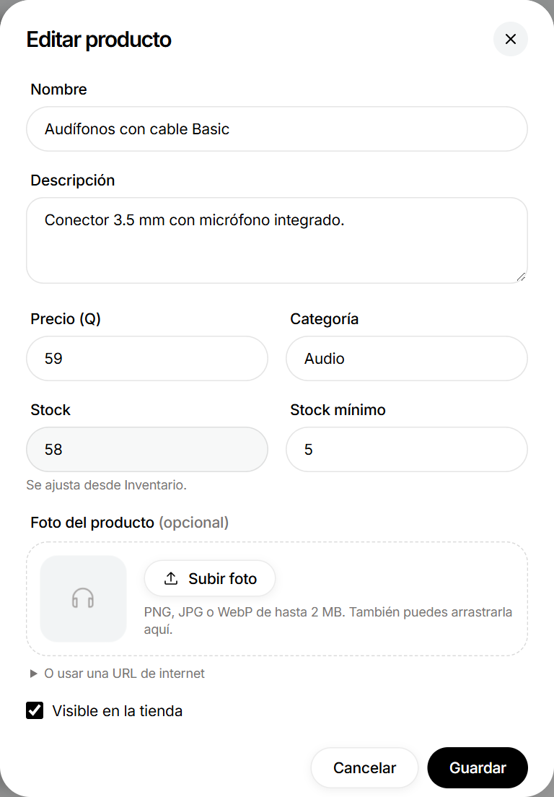

### 2.3 Inventario

1. Revisa la tabla: stock actual, mínimo, nivel (**Normal**, **Stock bajo**, **Agotado**) y valor del inventario.
2. Para registrar movimientos:
   - **−1** / **+1** / **+10** para ajustes rápidos.
   - O escribe una cantidad en **Ajustar (entradas + / salidas −)** y toca **Aplicar**
     (por ejemplo `25` al recibir mercadería o `-2` por productos dañados).
3. La tienda no permite que el stock quede negativo.
4. Activa **Mostrar solo productos con stock bajo** para ver qué hay que reabastecer.

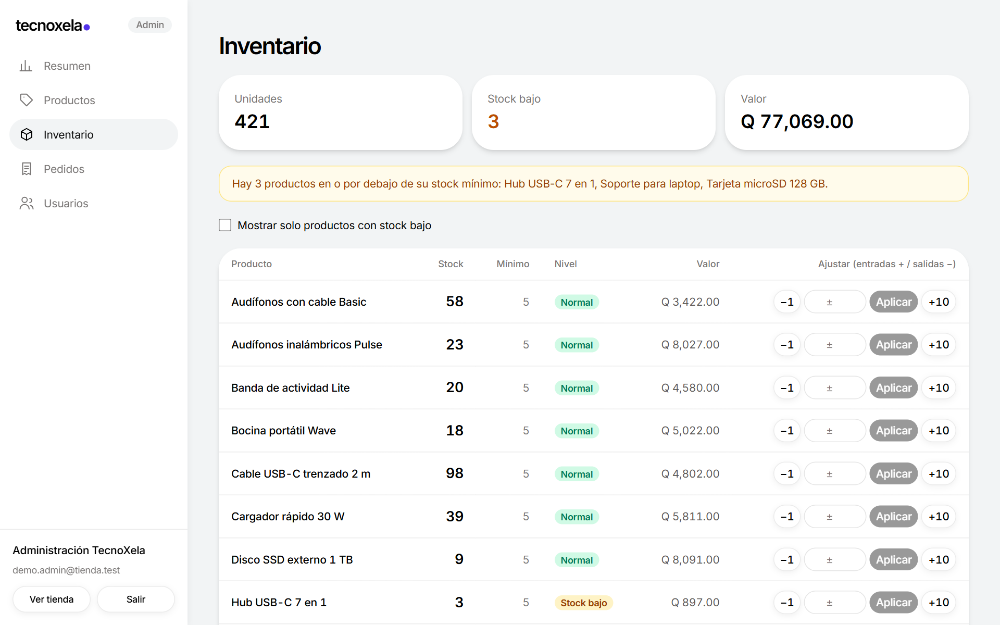

### 2.4 Pedidos

1. Usa los filtros **Todos, Pendiente, Enviado, Entregado, Cancelado** o busca por cliente, correo o número de pedido.
2. Toca un pedido para ver el detalle: cliente, contacto, dirección, productos, total y pago.
3. Avanza el pedido con los botones disponibles:
   - Pendiente → **Marcar como enviado** o **Cancelar pedido**
   - Enviado → **Marcar como entregado**
4. Al cancelar, las unidades regresan automáticamente al inventario. Al marcar como entregado un pedido
   contra entrega, su pago queda como aprobado.

La tienda solo permite estos pasos en orden; por ejemplo, no se puede entregar un pedido sin enviarlo antes.

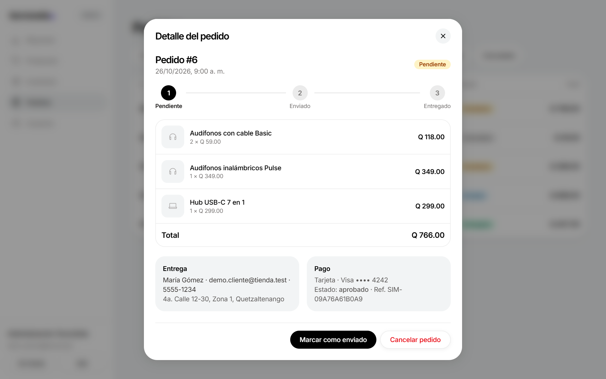

### 2.5 Usuarios y clientes

1. Busca por nombre o correo y filtra con **Todos los roles**, **Clientes** o **Administradores**.
2. La tabla muestra rol, estado, número de pedidos y **Total comprado** por cada usuario.
3. Toca un usuario para ver sus datos de contacto e **historial de pedidos**.
4. Acciones:
   - **Desactivar** / **Activar**: un usuario desactivado pierde el acceso de inmediato, aunque tenga la
     sesión abierta, y no puede volver a entrar.
   - **Hacer admin** / **Hacer cliente**: cambia el rol.
   - **+ Nuevo usuario**: crea un cliente o un administrador con una **contraseña temporal**, que la
     persona puede cambiar después desde **Mi perfil**.
5. No puedes desactivarte ni quitarte el rol a ti mismo (aparece marcado como **(tú)**).

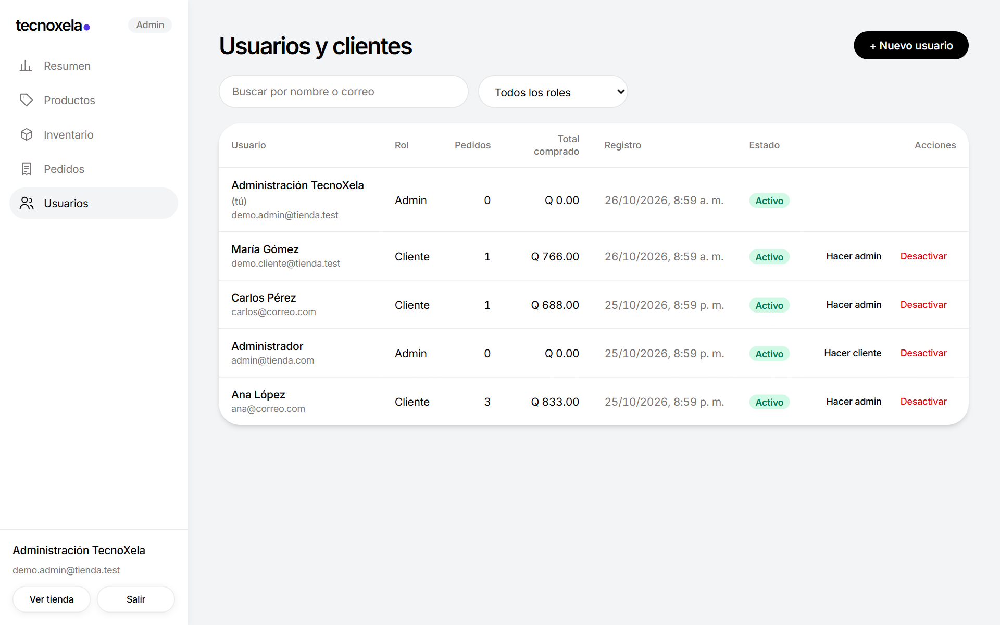

---

## Parte 3. Uso con teclado y accesibilidad

| Necesitas | Cómo |
|---|---|
| Moverte por la página | **Tab** avanza y **Mayús + Tab** retrocede; el elemento activo se marca con un contorno morado |
| Cerrar una ventana (detalle de pedido, confirmación, formulario) | **Escape** o el botón **×**. Si hay dos ventanas abiertas, Escape cierra solo la de arriba |
| Volver a donde estabas | Al cerrar una ventana, el foco regresa al botón que la abrió |
| Menos animaciones | Activa “Reducir movimiento” en tu sistema (Windows: *Configuración → Accesibilidad → Efectos visuales → Efectos de animación*; iPhone/Android: opciones de accesibilidad). La tienda quita los desplazamientos y deja solo fundidos |

---

## Parte 4. Preguntas frecuentes

| Pregunta | Respuesta |
|---|---|
| ¿Puedo comprar sin cuenta? | No. Puedes ver el catálogo, pero para el carrito y la compra necesitas iniciar sesión. |
| Olvidé mi contraseña | En **Iniciar sesión** toca **¿La olvidaste?** y sigue el enlace que te llega (ver 1.3.1). |
| “El enlace no es válido o ya venció” | El enlace dura 30 minutos, sirve una vez y se anula si pides otro. Pide uno nuevo. |
| “Tu contraseña cambió. Inicia sesión de nuevo.” | La contraseña se cambió desde otro dispositivo; entra con la nueva. |
| “No pudimos conectar con el servidor” | El backend no está corriendo o se reinició; espera unos segundos y reintenta. |
| “Algo salió mal” | La página tuvo un error inesperado. Toca **Recargar la página**; tu carrito no se pierde. |
| Mi pago fue rechazado, ¿se cobró algo? | No. Cuando un pago se rechaza no se crea el pedido ni se descuenta inventario. |
| El precio cambió después de mi compra | Tu pedido conserva el precio con el que compraste. |
| ¿La tienda guarda mi tarjeta? | No. Solo guarda la marca y los últimos 4 dígitos como comprobante. |
| “Tu cuenta está desactivada” | Un administrador desactivó la cuenta; contáctalo. |
| “Demasiados intentos” | Espera 15 minutos antes de volver a intentar iniciar sesión. |

---

## Anexo. Cuentas de demostración

Solo para la demostración local (se crean con `npm run db:reset`):

| Rol | Correo | Contraseña |
|---|---|---|
| Administrador | `admin@tienda.com` | `Admin123!` (o la definida en `ADMIN_PASSWORD`) |
| Cliente | `ana@correo.com` | `Cliente123!` |
| Cliente | `carlos@correo.com` | `Cliente123!` |
